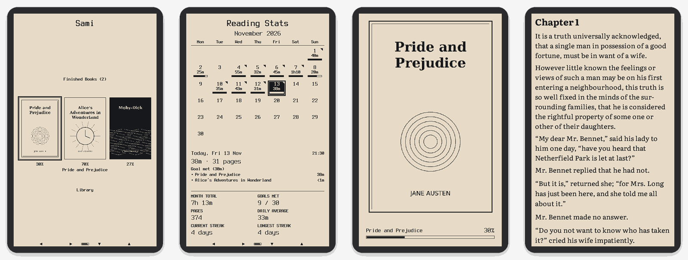
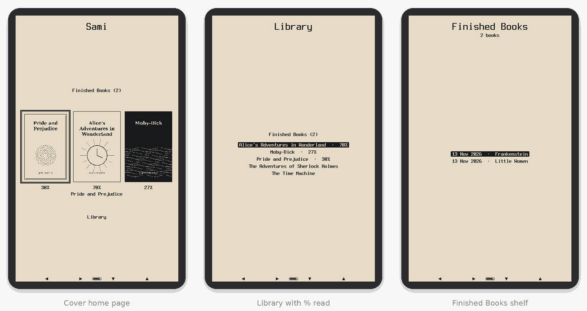
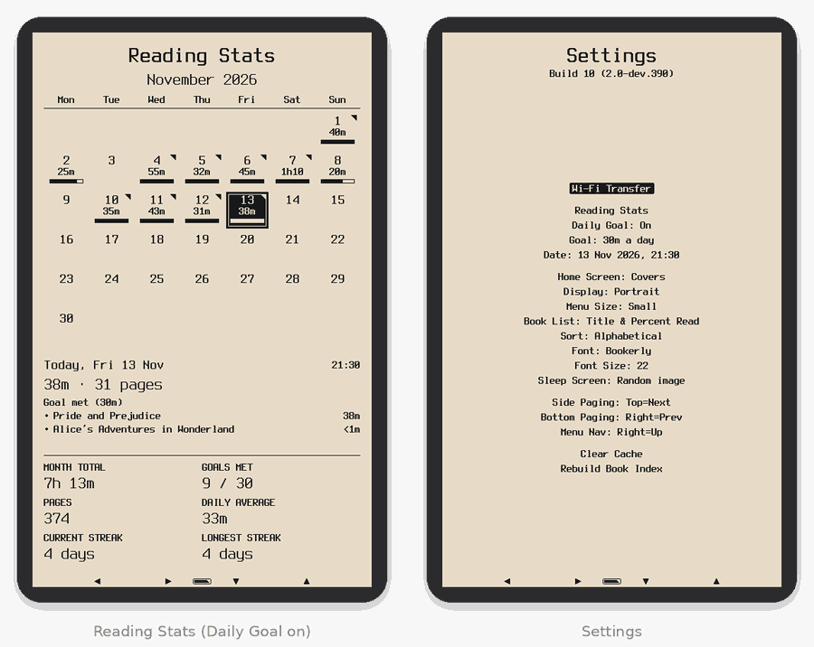
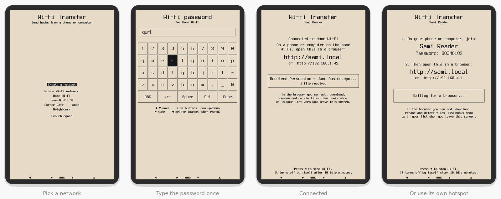
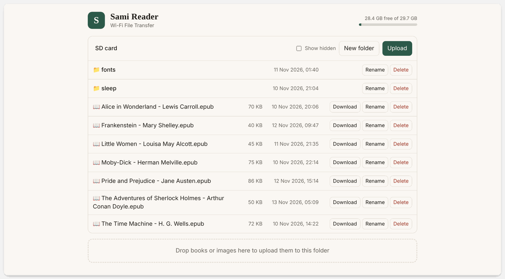
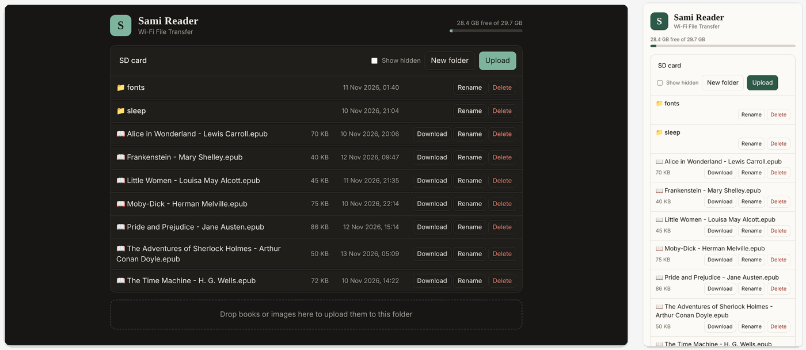

# Sami

**A fast, focused EPUB reader for the Xteink X4 and Xteink X3 e-readers** — with a cover home page, reading statistics, sleep screens that change every night, four built-in reading fonts and Wi-Fi book transfer from any phone or computer.



<p align="center">
  <a href="../../releases/latest/download/sami-firmware.bin"><b>⬇ Download for Xteink X4</b></a>
  &nbsp;·&nbsp;
  <a href="../../releases/latest/download/sami-firmware-x3.bin"><b>⬇ Download for Xteink X3</b></a>
  &nbsp;·&nbsp;
  <a href="../../releases">All releases</a>
  &nbsp;·&nbsp;
  <a href="#installing">How to install</a>
</p>

---

## About

Sami is custom firmware for the Xteink e-readers, built on top of [Microreader](https://github.com/CidVonHighwind/microreader) by CidVonHighwind. Microreader set out to do one thing very well — render EPUBs beautifully on a small e-ink screen, and stay out of the way — and Sami keeps that core exactly as it is.

What Sami adds is everything around the reading: a home page that opens on the books you're actually reading, a calendar that shows how much you read each day, a daily goal to keep a habit going, a shelf for the books you've finished, a sleep screen that shows something different every time you put the reader down, two extra fonts chosen for small screens, and a way to send books over Wi-Fi without a cable or an app.

It's a personal project, made for daily reading on a pocket-sized device. Every change is built automatically and published on the [Releases](../../releases) page, so installing or updating is a download and a few clicks in the browser.

## Available for X4 and X3

| Device | Firmware file | Status |
|---|---|---|
| **Xteink X4** | [`sami-firmware.bin`](../../releases/latest/download/sami-firmware.bin) | Main device, used daily |
| **Xteink X3** | [`sami-firmware-x3.bin`](../../releases/latest/download/sami-firmware-x3.bin) | **Experimental** — runs on a real X3 (screen, buttons and reading confirmed), still collecting feedback |

Both versions are built from the same code and have the same features. The X3 build drives the X3's 792×528 screen (either of its two display controllers, detected at start-up), its battery gauge and SD card power switch, and stores all four fonts ready to use inside the firmware.

> [!IMPORTANT]
> The two files are **not interchangeable**. The X4 file on an X3 (or the other way round) gives a scrambled screen. If that happens, just flash the right file — see [Installing](#installing).

## Features

**New in Sami**

- 🏠 **Cover home page** — the covers of your three most recent books with how far through each you are, plus Finished Books and the Library. Prefer a plain list? One setting switches back.
- 📊 **Reading Stats** — a month calendar of how long you read each day, which books, pages, totals, daily average and streaks.
- 🎯 **Daily Goal** — pick a target from 10 minutes to 2 hours; days that reach it get a flag and streaks count goal days.
- ✅ **Finished Books** — mark a book finished and it moves to its own shelf, dated, newest first.
- 📈 **Percent read in the Library** — e.g. *Pride and Prejudice · 30%*.
- ▬ **Chapter Bar** — a thin bar along the bottom of the page that fills as you get through the chapter, alongside the usual book progress.
- 🌙 **Sleep screen randomiser** — a random picture from your own folder every time (never the same twice in a row), or the cover of the book you're reading with its progress, or today's Reading Stats. JPEG, PNG and BMP.
- 📶 **Wi-Fi Transfer** — add, download, rename and delete books from a phone or computer browser, on your home Wi-Fi or the reader's own hotspot. Remembers your networks.
- 🔤 **Four built-in fonts** — Bookerly, Alegreya, **Literata** and **Atkinson Hyperlegible**, plus a **Font Size** setting right in Settings.
- 🕒 **Date & time** — set on the reader, kept through sleep, used to date your reading.

**From Microreader**

- Beautiful EPUB rendering: proportional fonts, bold and italic, inline images, justified text
- Hyphenation in English, German, French, Spanish, Italian, Dutch, Portuguese, Polish and Russian, picked automatically from the book's language
- Font, size, line spacing, margins, alignment — all adjustable per reader
- Table of contents, in-book links, and your place saved for every book
- Extra fonts from the SD card, swappable without reflashing
- Portrait or landscape
- FAT32 and exFAT SD cards
- USB file manager in the browser, a Calibre plugin, and a command-line tool

---

## A closer look

### ⚡ Speed

Sami is built to feel instant on a small, slow-refreshing screen:

- **Convert once, then everything is immediate.** The first time you open a book it's converted in a single pass into a compact binary format stored on the SD card. After that, opening the book, turning pages, jumping chapters and changing font size don't wait on the EPUB again.
- **Fast page flipping.** Text is drawn in crisp black and white while you turn pages; the smooth grey edges (anti-aliasing) are added only once you stop, so holding the button flips through pages quickly.
- **Covers and sleep images are prepared once.** Each book cover is decoded the first time it's shown and kept as a small ready-to-draw picture, so the home page appears straight away. Sleep images and book-cover sleep screens are converted once and cached the same way.
- **Light on memory.** Hyphenation patterns live in flash, not RAM, and Wi-Fi only turns on when you open Wi-Fi Transfer — it's off the rest of the time and never left running while the reader sleeps.

### 🏠 Home page, Library and Finished Books

The reader starts on your **cover home page**: the three books you opened most recently, how far through each you are, and the selected book's title. **▲/▼** move, **▶** opens, **◀** goes to Settings. Books without a cover get a plain title card.

The **Library** lists everything on the card, and **Settings → Book List** can show *Title*, *Title & Percent Read*, *Filename* or *Title & Author*. Finished books move off the list onto their own **Finished Books** shelf.

**Settings → Home Screen** switches between **Covers** and **Book List** if you'd rather start on the plain list.



### 📊 Reading Stats and Daily Goal

**Settings → Reading Stats** opens a calendar of the month. Each day shows how long you read with a small bar; select a day to see which books you read. Below: the month's total time, days read (or goals met), pages, daily average, and your current and longest streaks.

Turn on **Settings → Daily Goal** and choose a target (10, 15, 20, 25, 30, 45 minutes, 1, 1½ or 2 hours). Each day's bar then fills at your goal, days that reach it get a flag in the corner, and the day summary says *Goal met*, *18m to go* or *Goal missed*.

Only real reading counts: time on a page is credited when you turn it, capped at 3 minutes, so leaving the reader on doesn't inflate anything, and menus don't count. Stats are kept in small text files on the SD card (`.microreader/stats/`), and **Clear Cache** never touches them.



### 🌙 Sleep screen randomiser

**Settings → Sleep Screen** chooses what the reader shows while it sleeps:

| Option | What you see |
|---|---|
| **Random image** *(default)* | A random picture from your `sleep` folder every time — never the same one twice in a row |
| **Book cover** | The cover of the book you're reading, with its title and percent read |
| **Reading stats** | This month's Reading Stats with today selected |

Drop `.jpg`, `.jpeg`, `.png` or `.bmp` files into a folder called `sleep` on the SD card — or upload them over Wi-Fi. Pictures around **480×800** look best; landscape images are turned sideways to fill the screen. Each image is converted once, the first time it's shown, so later sleeps are quick. Sleep screens show just the picture — no "sleeping…" text on top.


### 🔤 New fonts

Sami adds two fonts made for reading on small screens, next to Microreader's Bookerly and Alegreya:

- **Literata** — a book serif, in its version cut for small text
- **Atkinson Hyperlegible** — a clear sans-serif designed for maximum legibility

Choose one in **Settings → Font**, and set the size (20–32) in **Settings → Font Size** — the same setting as *Font Size* in the book menu. Any `.mfb` fonts in the SD card's `fonts` folder show up in the same list.


### 📶 Wi-Fi Transfer

Send books to the reader from any phone, tablet or computer — no cable, no app.

1. **Settings → Wi-Fi Transfer** (the first item).
2. Pick your network and type its password once with the on-screen keyboard — Sami remembers it. Or choose **Create a hotspot** and join the network called **Sami Reader** from your phone (handy away from home).
3. Open **http://sami.local** in a browser — or the number address the reader shows, like `http://192.168.1.42` (on the hotspot it's always `http://192.168.4.1`).



Press **◀** when you're done; new books are already in your Library. Wi-Fi also switches itself off after 10 minutes without activity.

> The reader's Wi-Fi works on **2.4 GHz** networks. The page has no password, so use Wi-Fi Transfer at home or on the reader's own hotspot rather than on public Wi-Fi.

### 🖥 Sami Reader Manager (in your browser)

The page you open at **sami.local** is the **Sami Reader** manager: it lists the SD card's folders and files and lets you **upload** (button or drag and drop, several files at once, with progress), **download**, **rename**, **delete** and create **new folders**. It shows free space, hides system files unless you tick *Show hidden*, follows your device's light or dark mode, and fits phone screens.





### ▬ Chapter Bar

While reading, press **▶** for the book menu and turn on **Chapter Bar**. An outlined bar along the very bottom of the page fills as you read through the chapter, and your usual progress indicator moves just above it — so you can see both at a glance.

<p align="center"></p>

---

## Installing

> [!WARNING]
> Sami needs an **unlocked** reader — one that already runs Microreader, Sami or CrossPoint. If yours still runs the original Xteink firmware, install CrossPoint first from the same flasher page (step 3), which unlocks it.

You need the reader charged above ~30%, a **USB-C data cable**, and a computer with **Chrome** or **Edge** (Safari and Firefox can't talk to the reader).

1. **Download** the file for your device: [X4](../../releases/latest/download/sami-firmware.bin) or [X3](../../releases/latest/download/sami-firmware-x3.bin).
2. Turn the reader on and plug it straight into the computer. Close any other page that's connected to it.
3. Open the **[CrossPoint web flasher](https://crosspointreader.com/#flash-tools)** and choose your model (**Xteink X4** or **Xteink X3**).
4. Choose **Custom .bin**, pick the file you downloaded, click **Flash**, select the reader in the pop-up and **Connect**.
5. Wait until it's done, then restart the reader if it doesn't restart by itself: unplug, press the small **reset** button, then hold **power** for 3–5 seconds. The home page now says **Sami**.
6. First time only: set the date — on the home page press **◀** for Settings and select **Date**.

Your books, reading positions and settings live on the SD card and are kept.

**Updating:** download the latest file and repeat steps 2–5. Your stats, finished shelf, Wi-Fi networks and settings stay.

**Going back (X4):** the flasher installs Sami next to your previous firmware. **Settings → Switch to app0 / app1** (at the very bottom) restarts into the other one. On the X3, flash the old firmware again with the web flasher.

**Which version do I have?** It's under the title in Settings, e.g. *Build 10 (2.0-dev.390)*.

<details>
<summary>Flashing from the command line instead (esptool)</summary>

Sami's release files are app images for the reader's spare firmware slot. With [esptool](https://docs.espressif.com/projects/esptool/en/latest/), write the file to the slot you want and point the boot record at it:

```bash
# X4: app0 starts at 0x10000, app1 at 0x650000
python -m esptool --chip esp32c3 --port /dev/ttyACM0 --baud 921600 write_flash 0x10000 sami-firmware.bin
python tools/switch_partition.py app0 --port /dev/ttyACM0 --flash
```

Replace the port with yours (`COM5` on Windows, `/dev/cu.usbmodem*` on macOS).
</details>

## Getting books onto the reader

| Way | How |
|---|---|
| **Wi-Fi Transfer** | Settings → Wi-Fi Transfer, then open **sami.local** in any browser. [Details](#-wi-fi-transfer) |
| **SD card** | Copy `.epub` files anywhere on the card — Sami finds them in every folder. Fonts go in `fonts/`, sleep images in `sleep/`. |
| **USB browser manager** | Open the [Microreader Manager](https://cidvonhighwind.github.io/microreader/) in Chrome or Edge with the reader plugged in: upload books, fonts and sleep images over the cable. Connecting it also sets the reader's clock. |
| **Calibre** | Send books straight from your Calibre library — see below. |

<p align="center"></p>

### Calibre plugin

Send and delete books on the reader from [Calibre](https://calibre-ebook.com), over USB.

1. In Calibre: **Preferences → Plugins → Load plugin from file** and choose [`tools/calibre-plugin/microreader.zip`](tools/calibre-plugin/microreader.zip).
2. Restart Calibre and plug in the reader.

The reader is detected automatically (it appears as *Microreader*, since Sami speaks the same USB protocol). Books already on it get a checkmark in your library; use **Send to device** and the Device view as with any e-reader. Requires Calibre 5 or newer, on Windows, macOS or Linux.

### Custom fonts

Make your own `.mfb` reader fonts from any TTF/OTF with the **Font Generator** in the [browser manager](https://cidvonhighwind.github.io/microreader/) — live preview, size presets and character-range presets — and put them in the SD card's `fonts/` folder. A font file can be up to 3.375 MB on the X4; the X3 has less room for SD fonts and says *Font too large!* if one doesn't fit.

<p align="center"></p>

## Buttons

| Where | ◀ | ▶ | ▲ / ▼ (front) | Side buttons |
|---|---|---|---|---|
| **Home page** | Settings | Open | Move | Move |
| **Lists & Settings** | Back | Select / change | Move | Move |
| **Reading** | Back | Book menu | Turn page | Turn page |
| **Reading Stats** | Back | Set date & time | Previous / next day | Previous / next month |
| **Wi-Fi keyboard** | Delete | Type key | Move along keys | Row up / down |

Page-turn and menu directions can be flipped in **Settings → Side Paging / Bottom Paging / Menu Nav**. The power button puts the reader to sleep; it also sleeps by itself after 10 minutes.

---

## Building from source

### The easy way: GitHub builds it for you

Every push to this repository runs [`.github/workflows/build-firmware.yml`](.github/workflows/build-firmware.yml), which:

1. builds both firmware files (`esp32c3` for the X4, `esp32c3-x3` for the X3) with exFAT support,
2. checks each file is a valid app image, that the two differ, and that each fits its device's firmware slot (X4: 6.25 MB, X3: 7.4 MB),
3. publishes them as a release.

Releases are named from the first line of [`release.txt`](release.txt) — `Build 10 - homepage options and fonts` becomes tag `build-10` — and the lines after it become the release's *What's new*. Pushing again with the same name replaces that release. Nothing needs to be installed on your computer.

### Building locally

| Tool | For |
|---|---|
| [PlatformIO](https://platformio.org/) | Firmware for the reader (installs the ESP-IDF toolchain itself) |
| CMake 3.16+ and a C++ compiler (GCC, Clang or MSVC) | Desktop emulator and tests |
| Python 3 | Build scripts and tools (`pip install -r tools/requirements.txt`) |

**Firmware:**

```bash
pio run -e esp32c3            # Xteink X4  → .pio/build/esp32c3/firmware.bin
pio run -e esp32c3-x3         # Xteink X3  → .pio/build/esp32c3-x3/firmware.bin
pio run -e esp32c3 -t upload  # build and flash over USB
pio device monitor -b 115200  # serial log
```

**Desktop emulator** — the whole reader in a window, no hardware needed (SDL2 is downloaded automatically):

```bash
cmake -S platforms/desktop -B build/desktop -DCMAKE_BUILD_TYPE=Release -DCMAKE_POLICY_VERSION_MINIMUM=3.5
cmake --build build/desktop
./build/desktop/microreader_desktop        # Windows: build\desktop\Release\microreader_desktop.exe
```

It uses the repository's `sd/` folder as its SD card: put `.epub` files there, fonts in `sd/fonts/`, sleep images in `sd/sleep/`. Keys: **← →** are ◀ ▶, **↑ ↓** the front buttons, **Q / A** the side buttons, **Enter** is power. The screenshots in this README were taken from the emulator, using public-domain books.

**Tests** (Google Test, downloaded automatically):

```bash
cmake -S test -B test/build -DCMAKE_BUILD_TYPE=Debug -DCMAKE_POLICY_VERSION_MINIMUM=3.5
cmake --build test/build
./test/build/unit_tests            # fast unit tests
./test/build/microreader_tests     # also runs real EPUB integration tests
```

<details>
<summary>QEMU — run the real firmware without a device</summary>

```bash
python tools/run_qemu.py --with-books                                          # terminal 1
python tools/test_books.py --port socket://localhost:4444 --pages 20 --delay 0.1  # terminal 2
```
</details>

<details>
<summary>Serial command line</summary>

`tools/serial_cmd.py` talks to the reader over USB using the same protocol as the browser manager.

```bash
python tools/serial_cmd.py --port COM5 --upload "book.epub"          # upload a book
python tools/serial_cmd.py --port COM5 --upload-dir "path/to/books"  # upload a folder (skips duplicates)
python tools/serial_cmd.py --port COM5 --upload-sleep "image.png"    # upload a sleep image
python tools/serial_cmd.py --port COM5 --upload-sd-font "font.mfb"   # upload a font
python tools/serial_cmd.py --port COM5 --list                        # list books
python tools/serial_cmd.py --port COM5 --sync-time                   # set the reader's clock from this computer
python tools/serial_cmd.py --port COM5                               # interactive mode — type `help`
```
</details>

<details>
<summary>Backing up and restoring the X4's flash</summary>

The X4 has two firmware slots — `app0` at `0x10000` and `app1` at `0x650000` — and a boot record at `0xE000` that says which one starts.

```bash
# Back up everything (16 MB) / one slot
python -m esptool --chip esp32c3 --port COM5 read_flash 0x0 0x1000000 full_backup.bin
python -m esptool --chip esp32c3 --port COM5 read_flash 0x10000 0x640000 app0_backup.bin

# Restore
python -m esptool --chip esp32c3 --port COM5 write_flash 0x0 full_backup.bin

# Choose which slot boots
python tools/switch_partition.py app0 --port COM5 --flash
```
</details>

<details>
<summary>Calibre plugin development</summary>

The plugin lives in `tools/calibre-plugin/` and bundles `pyserial`, which Calibre's Python doesn't include.

```bash
cd tools/calibre-plugin
python build.py             # → microreader.zip
python build.py --install   # …and copy it into Calibre's plugins folder
calibre-debug -g            # run Calibre with the plugin's log in the terminal
calibre-debug -e test.py    # check device detection and the protocol without the Calibre window
```
</details>

<details>
<summary>Adding a hyphenation language</summary>

Hyphenation uses the [Liang/TeX algorithm](https://tug.org/docs/liang/) with patterns compiled by [Typst hypher](https://github.com/typst/hypher), stored as constant tables in `lib/microreader/content/hyphenation/Liang/`.

1. Download the language's `.bin` from [typst/hypher/tries](https://github.com/typst/hypher/tree/main/tries) into `tools/hyphenation/`.
2. `python tools/generate_trie_header.py tools/hyphenation/<lang>.bin lib/microreader/content/hyphenation/Liang/hyph-<lang>.trie.h <lang>`
3. Add the language to `HyphenationLang` in `Hyphenation.h`, and to `hyphenate_word` and `detect_language` in `Hyphenation.cpp`.
</details>

### Project layout

```
lib/microreader/        the reader itself — platform-independent C++
  content/              EPUB parsing, layout, hyphenation, the .mrb book format
  screens/              every screen: home, library, reader, settings, stats, Wi-Fi…
  stats/  library/      reading statistics, finished shelf, percent read
  net/                  Wi-Fi Transfer: file server API and the Sami Reader web page
platforms/esp32/        firmware for the X4 and X3 (displays, buttons, SD card, Wi-Fi)
platforms/desktop/      SDL2 desktop emulator
test/                   unit and integration tests
tools/                  build scripts, serial tool, Calibre plugin, font tools
docs/                   USB browser manager and Font Generator (GitHub Pages)
resources/              fonts and built-in sleep images
```

---

## Where Sami keeps things on the SD card

| Path | What |
|---|---|
| `*.epub` (any folder) | Your books |
| `fonts/` | Extra `.mfb` fonts |
| `sleep/` | Your sleep screen pictures |
| `.microreader/stats/` | Reading Stats, one file per month |
| `.microreader/finished.txt` | The Finished Books shelf |
| `.microreader/wifi.txt` | Remembered Wi-Fi networks |
| `.microreader/cache/` | Converted books and cover thumbnails — safe to clear with **Settings → Clear Cache** |

## Troubleshooting

- **The flasher can't find the reader** — try another USB-C cable (many are charge-only), another port, and make sure the reader is awake and no other tab is connected to it.
- **Blank screen after flashing** — press reset, then hold power for 3–5 seconds.
- **Scrambled or mirrored screen** — the wrong file for the device; flash the other one.
- **My Wi-Fi isn't listed** — it may be 5 GHz only. Choose the 2.4 GHz network, move closer and *Search again*, or use the hotspot.
- **sami.local doesn't open** (common on Android) — type the number address shown on the reader instead.
- **A cover or sleep image looks wrong** — **Settings → Clear Cache** prepares it again. Very large photos may not decode; resize them to about 480×800 and save as a regular (not progressive) JPEG or PNG.

## Credits

- **[Microreader](https://github.com/CidVonHighwind/microreader)** by CidVonHighwind — the reader engine, rendering, browser manager, font generator and Calibre plugin that Sami is built on.
- **X3 display driver** ported from [PapyriX](https://github.com/bigbag/papyrix-reader) and the FreeInk SDK (MIT) — see [THIRD_PARTY.md](THIRD_PARTY.md).
- **Fonts:** [Literata](https://github.com/googlefonts/literata) and [Atkinson Hyperlegible](https://github.com/googlefonts/atkinson-hyperlegible) under the SIL Open Font License.
- **Flashing:** the [CrossPoint](https://crosspointreader.com/#flash-tools) web flasher.
- Hyphenation patterns via [Typst hypher](https://github.com/typst/hypher).

## License

GPL v2 — see [LICENSE](LICENSE). Third-party components keep their own licenses; see [THIRD_PARTY.md](THIRD_PARTY.md).
